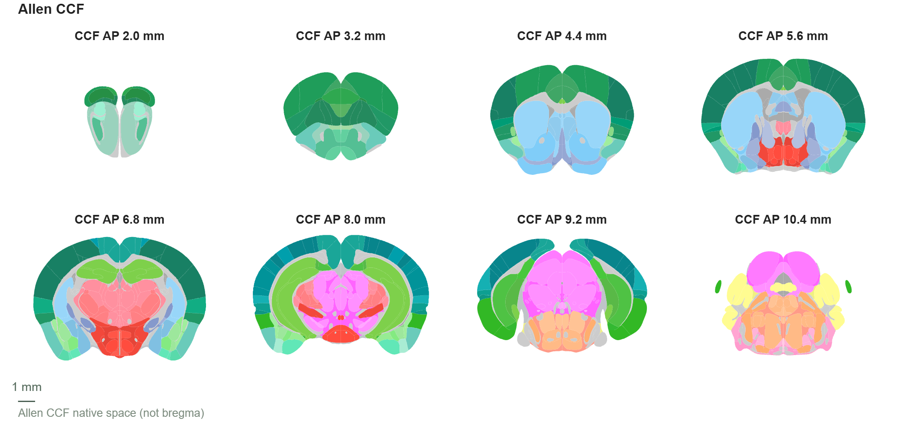
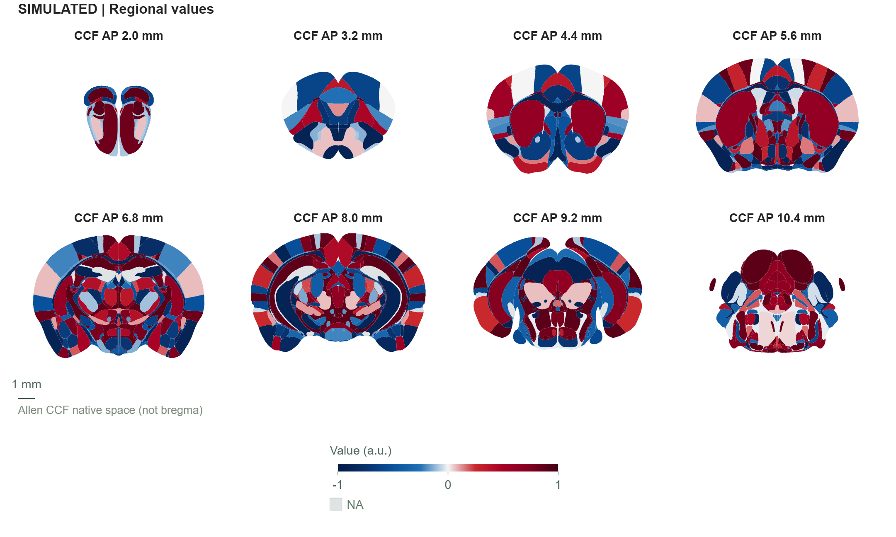
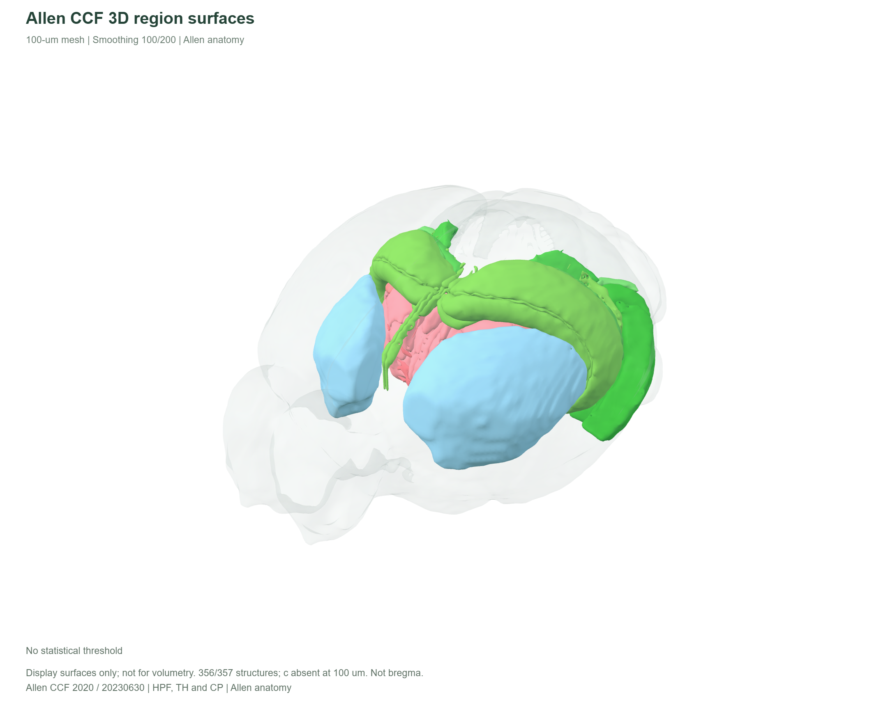

# BRAIN_P

小鼠脑图谱与NIfTI结果展示工具。支持脑区数值赋值、统计图叠加、三维显示和图版导出，可在本地离线使用。

[下载 v3.20.0-beta.1](https://github.com/wulala-aichi/BRAIN_P/releases/tag/v3.20.0-beta.1) · [使用说明](docs/使用说明.md) · [问题反馈](https://github.com/wulala-aichi/BRAIN_P/issues)

## 开始使用

1. 在发布页下载 `BRAIN_P-3.20.0-beta.1-offline.zip`。
2. 解压，用Chrome或Edge打开其中的 `index.html`。
3. 浏览图谱，或导入自己的脑区CSV、NIfTI模板和统计图。

离线版的图谱与NIfTI功能不需要安装Node或Python。发布页中的 **Source code** 是源码，运行方法见下方。

## 示例

### 图谱切片



Allen CCF分区配色，8个冠状切面。行列数、片层位置、间距、分区边界和文字标注均可调整。

### 脑区数值伪彩



蓝红色带表示模拟数值的方向和大小，灰色表示缺失。这里的数据只用于演示，不代表动物实验结果或统计显著性。[下载示例CSV](examples/SIMULATED_showcase_values.csv)；生成规则见[图片来源记录](docs/images/PROVENANCE.json)。

### 三维脑区



海马结构（HPF）、丘脑（TH）和尾壳核（CP）的空间位置，透明整脑外壳作为参照。图中使用Allen分区颜色和100 µm显示网格。

以上图片均由软件直接导出。

## 主要功能

- **常规图谱**：冠状面、矢状面、水平面；单片、三视图及自定义行列；片层与间距调节。
- **区域赋值**：按脑区缩写或Allen ID导入CSV；支持左、右、双侧赋值，色阶、色条及导入p/q阈值。
- **NIfTI展示**：加载本地模板、统计图和掩膜；选择4D帧；显示t/Z/F、效应量或概率图，调节阈值、簇范围和平滑。
- **三维与标注**：脑区表面、点与网络；注射位点、光纤和电极示意。
- **出图与保存**：组合图版，导出SVG、PNG、PDF、TIFF，保存完整项目以恢复图层和设置。

## 导入数据

常规脑区赋值可用如下CSV：

```csv
region,value,hemisphere
MOp,0.8,B
MOs,-0.5,B
ACAd,0,B
DG,NA,B
```

`B`为双侧，`L`和`R`为单侧。`0`是有效数值，`NA`是缺失值，两者分开显示。完整格式见[使用说明](docs/使用说明.md)。

NIfTI统计图需要预先配准到模板空间，并具有正确的affine和空间单位。软件提供阈值与簇范围过滤，不执行图像配准；簇大小过滤不能代替FWER/FDR校正。见[MRI使用指南](docs/MRI_ADVANCED_GUIDE_ZH.md)。

## 坐标与分辨率

图谱采用Allen CCF坐标：AP、DV从体积边缘起算，ML依据原始affine，**不是bregma坐标**。切片浏览间隔为0.1 mm，边界来自原10 µm annotation切面；3D表面和点标签查询约为100 µm显示近似，不能据表面网格进行精确体积测量。

## 从源码运行

安装Node.js 22或24，下载或克隆源码后运行：

```sh
node scripts/test.mjs
node build.mjs
node scripts/serve.mjs
```

然后访问 `http://127.0.0.1:8766/`。也可直接打开构建后的 `dist/index.html`。

生成用于测试的区域CSV和NIfTI文件：

```sh
node scripts/generate-example.mjs
```

文件保存在 `examples/generated/`。其中NIfTI模板是合成椭球体，统计图为任意模拟数值；导入时选择“原始数值”阈值模式。

## 可选本地数据服务

MERFISH和AAV模块需要自行准备源数据与Python环境，目前作为实验性功能提供。

```sh
python -m venv .venv
# 激活虚拟环境后：
python -m pip install -r requirements.txt
python tools/merfish_server.py --root /path/to/abc_atlas
```

Windows也可使用 `scripts/start-local-data.ps1`；AAV目录通过重复的 `--aav-root` 参数指定。服务只监听本机127.0.0.1，GitHub Pages不能运行这个Python服务。见[本地数据说明](docs/本地MERFISH伪彩使用说明.md)。

## 文档与反馈

当前版本为研究Beta。核心测试和构建已在Windows、Linux及Node 22/24上通过；可选数据服务和完整跨浏览器流程仍需测试。

[界面指南](docs/新版界面上手指南.md) · [已知限制](docs/KNOWN_LIMITATIONS.md) · [版本记录](CHANGELOG.md) · [CI记录](https://github.com/wulala-aichi/BRAIN_P/actions)

反馈问题时请附版本、操作系统、浏览器和复现步骤。优先使用模拟数据；完整项目可能嵌入图像、数值和来源路径，分享前请检查。

## 许可与引用

原创代码采用[MIT许可证](LICENSE)。Allen图谱数据、第三方库和字体保留各自条款，见[图谱数据许可](DATA_LICENSES.md)与[第三方说明](THIRD_PARTY_NOTICES.md)。使用图谱或软件生成论文图片时，请引用实际使用的资源；本项目引用信息见 `CITATION.cff`。
